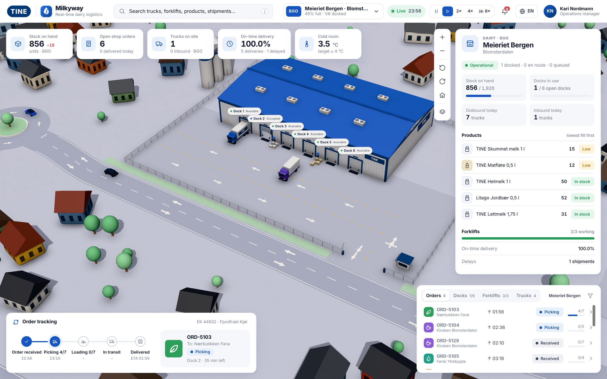
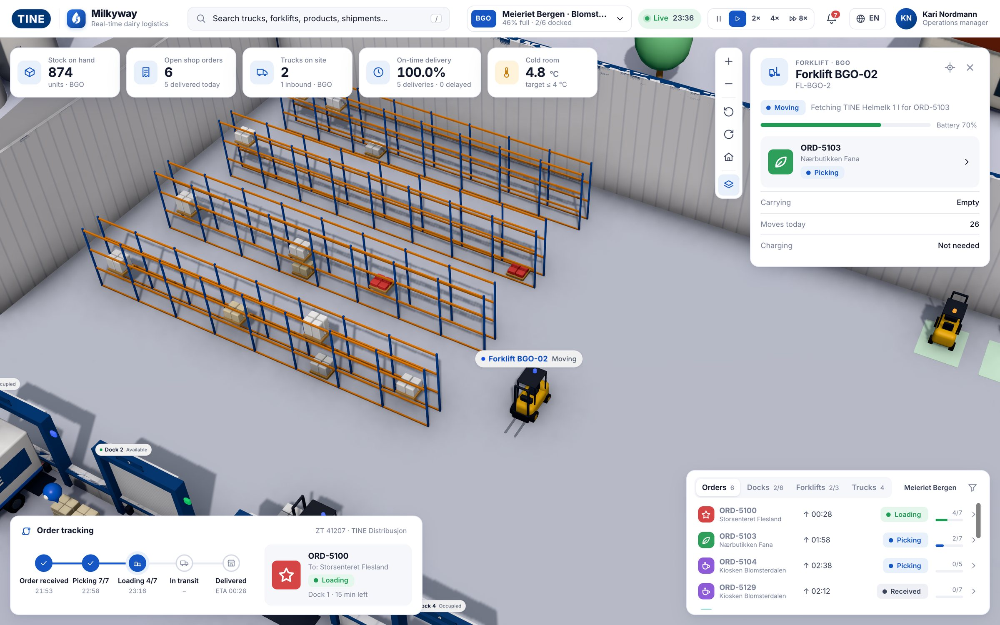
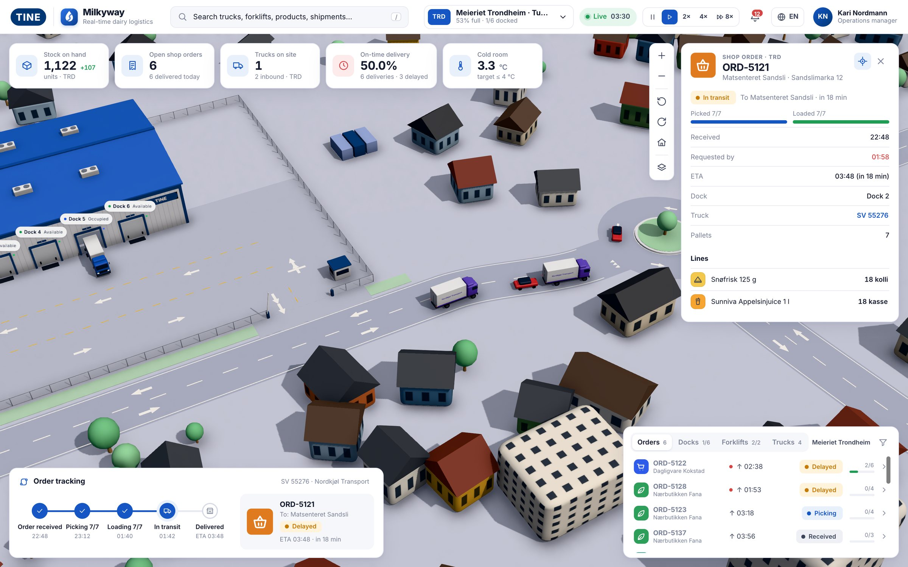
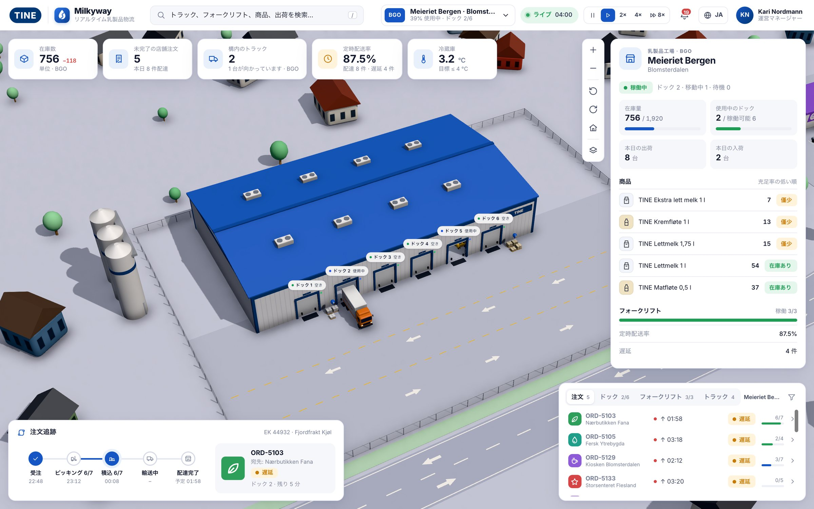

# Milkyway

**Real-time dairy logistics as a living 3D world.** Dairies, forklifts, trucks, roundabouts and shops, all driven by one live data model. In Norwegian the app is called *Melkeveien*.

**[▶ Open the live demo](https://compiledex.github.io/milkyway/)**



> **Unofficial demo.** This is a personal test project. It is not affiliated with or endorsed by TINE SA. The TINE logo is a drawn placeholder, and all stock levels, orders, carriers, plates and shops are made-up test data.

Built with React 19, React Three Fiber, drei, postprocessing and Zustand. Inspired by the "WareTrack" warehouse demo built entirely with Claude Code.

## What you see

- **Three dairies:** Bergen, Oslo and Trondheim, each with a warehouse, six loading docks, racks, forklifts and chargers. Zoom in, or press the layers button, and the roof lifts off so you can see inside.
- **Shop orders end to end:**
  1. A shop places an order.
  2. Forklifts pick pallets to a dock.
  3. A truck reverses in and is loaded.
  4. The truck drives to the shop and unloads.
  5. The truck drives back.

  Every step is time-stamped and can be followed in the order tracker.
- **Goods in:** supplier trucks arrive from the edge of the map and unload, and forklifts put the pallets away.
- **Traffic:** trucks and cars drive on the right, follow lane arrows and give way at roundabouts. They keep their distance and cannot collide (see below).
- **Town:** houses, apartment blocks, shops with car parks and loading bays, and trees, laid out irregularly.



## Using it

- **Navigate:**
  - Drag to pan.
  - Right-drag to rotate.
  - Scroll to zoom.

  The buttons on the right do the same.
- **Search:** press `/` to search orders, shops, trucks, forklifts and products.
- **Fast-forward:** the buttons next to the clock pause time or run it at 1×, 2×, 4× or 8×. They are only available on test data; a real API always runs in real time.
- **Follow a vehicle:** click a truck, forklift or order and the camera follows it, and you can scroll to zoom while following. Dragging the map hands control back to you; turn following on again with the target button in the panel.
- **Language:** English (default), Norwegian or Japanese, from the 🌐 button. Your choice is remembered.





## Getting started

```bash
npm install
npm run dev
```

Open http://localhost:5173.

```bash
npm run build   # type-check and production build into dist/
npm run lint    # oxlint
```

## Architecture: data first, 3D is just a view

```
src/data/       Domain model (types.ts), rules, site layout, world plan, test-data seed
src/api/        Data sources: WarehouseDataSource, HttpDataSource (real API), mock/ (full simulation)
src/store/      Zustand store and selectors (KPIs, filters)
src/scene/      3D view
  traffic/      Road network (lanes, roundabouts, shop loops) and traffic simulation
src/ui/         Top bar, KPIs, inspector, order tracking, activity lists
src/i18n/       English, Norwegian and Japanese strings
src/brand/      Brands (TINE/Milkyway and a generic WareTrack skin)
```

### Collision-free traffic

The 3D traffic follows the data: the data says where each truck should be and when, and `scene/traffic/controller.ts` decides how it gets there.

- **Reservations:** the world is a 1 m grid. Every vehicle owns the cells it occupies and the ones it is about to drive into, so it stops behind whoever is in front.
- **Junction boxes:** roundabouts, the gate, reversing into a dock and pulling out are "boxes" that must be reserved as a whole before a vehicle enters. Nobody gets stuck in the middle of a junction.
- **Fair queues:** whoever has waited longest at a box goes first.
- **Test hooks:** in dev mode, `window.__collisions` counts any overlap between vehicles.

## Connecting real data

Copy `.env.example` to `.env` and set `VITE_WARETRACK_API_URL`. The backend must provide:

| Endpoint | Response |
|---|---|
| `GET /snapshot` | `WarehouseSnapshot` (see `src/data/types.ts`) |
| `GET /events` (optional) | Server-Sent Events, where each `data:` is a `WarehouseSnapshot` |

A snapshot contains `sites`, `customers` (shops with location and driving times), `docks`, `trucks`, `forklifts`, `inventory`, `shipments` and optionally `sensors`.

- **Shipments** are both shop orders (`outbound`) and goods in (`inbound`). Each has an `events` log with timestamps: received, picked, loaded, departed, arrived, delivered and so on. The order tracker only shows times that actually exist in that log.
- **Polling:** without `/events`, the app re-fetches `/snapshot` at a fixed interval.
- **Auth:** `VITE_WARETRACK_API_TOKEN` is sent as `Authorization: Bearer …`.

Anything prefixed `VITE_` is baked into the JavaScript bundle and is readable by anyone who loads the page, so do not put a real secret there. Put a small proxy in front of the API instead.

## Branding

`VITE_BRAND=tine` (default) or `VITE_BRAND=waretrack`. To use an official logo file, put it in `public/brand/` and set `TINE_LOGO_URL` in `src/brand/logos.tsx`.

## Deployment

Every push to `main` builds the app and publishes it to GitHub Pages (`.github/workflows/deploy.yml`). The build uses relative asset paths (`base: './'` in `vite.config.ts`), so it works under any sub-path.
